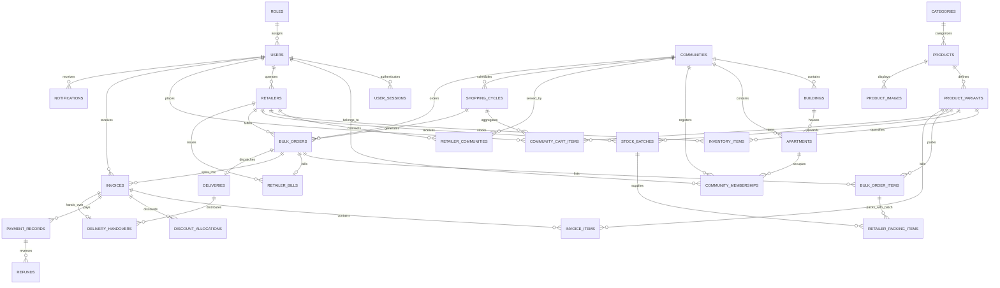

# PACT — Relational Database Schema & Domain Architecture

## 1. Overview
The PACT platform uses **PostgreSQL 16** as the persistent relational source of truth. The database is managed via **SQLAlchemy 2.0** declarative models and **Alembic** migrations.

### Core Invariants & Guarantees
1. **UUID Primary Keys**: Every table uses a `UUID(as_uuid=True)` primary key generated by `gen_random_uuid()` at the database level and `uuid.uuid4()` at the application level.
2. **Integer Paise Representation**: All monetary values (`mrp_paise`, `default_price_paise`, `subtotal_paise`, `total_amount_paise`, `delivery_fee_paise`, `discount_paise`) are stored strictly as `INTEGER` representing paise (`₹1 = 100 paise`). Floating-point arithmetic is strictly forbidden.
3. **UTC Timestamps**: All temporal columns (`created_at`, `updated_at`, `cutoff_at`, `expires_at`, `paid_at`) use `DateTime(timezone=True)` stored in UTC. Local time calculations (e.g. 5:27 PM IST cutoff) are projected only during business cycle calculations using `Asia/Kolkata`.
4. **Financial Immutability & Audit Safety**: Deletion of critical financial entities (`bulk_orders`, `invoices`, `retailer_bills`, `payment_records`) is strictly restricted using `ondelete="RESTRICT"`. Financial history cannot be cascade-deleted.

---

## 2. Multi-Tenancy Architecture & Access Boundaries

Multi-tenancy in PACT is governed by three primary scoping dimensions:

| Scoping Dimension | Scope Identifier | Description | Protected Entities |
|---|---|---|---|
| **Community Tenancy** | `community_id` | Enforces isolation between different apartment complexes. Residents and admins of Community A can never inspect or mutate data from Community B. | `apartments`, `community_memberships`, `shopping_cycles`, `community_cart_items`, `bulk_orders`, `invoices`, `deliveries` |
| **Retailer Tenancy** | `retailer_id` | Isolates inventory, supplier batches, pricing overrides, and fulfillment orders for a specific kirana merchant. A single retailer can serve multiple communities via `retailer_communities`. | `retailers`, `retailer_communities`, `inventory_items`, `stock_batches`, `inventory_movements`, `reorder_rules`, `retailer_bills` |
| **User Tenancy** | `user_id` | Isolates resident personal data, private cart contributions, individual invoice receipts, notifications, and payment methods. | `users`, `user_sessions`, `community_cart_items`, `invoices`, `payment_records`, `notifications` |

### Tenant Access Rules
- **Residents**: Read catalogue; write to `community_cart_items` where `user_id == current_user.id` and `cycle.status == "OPEN"`; view only their own `invoices` and `notifications`.
- **Retailers**: Read `bulk_orders` where `retailer_id == current_retailer.id`; update `packed_qty` on items; manage their own `inventory_items` and `stock_batches`.
- **Apartment Admins**: Read `bulk_orders`, `deliveries`, and aggregate collection metrics where `community_id == admin.community_id`; trigger delivery handovers.
- **Platform Admins**: Global read/write access across communities and retailers.

---

## 3. Entity Relationship Diagram (ERD)



---

## 4. Entity Specifications

### 4.1 Identity Module
- **`roles`**: System roles (`customer`, `retailer`, `community_admin`, `platform_admin`).
- **`users`**: Canonical user accounts keyed by phone number (`+91...`).
- **`user_sessions`**: Active login sessions storing SHA-256 token hashes, expiration, and revocation status.
- **`otp_verifications`**: OTP generation records storing hashes, attempts counter, and expiration timestamps.

### 4.2 Organization Module
- **`communities`**: Residential complexes (e.g. Green Meadows) with unique alphanumeric society code.
- **`buildings`**: Towers/wings within a community.
- **`apartments`**: Specific flats/units (e.g. `A-101`) with unique constraint on `(community_id, unit_number)`.
- **`community_memberships`**: Connects users to apartments and communities with assigned roles (`resident`, `admin`).
- **`retailers`**: Kirana merchant profiles storing business address, GSTIN, and merchant contact.
- **`retailer_communities`**: Association table linking retailers to societies with community-specific delivery fees.

### 4.3 Catalogue Module
- **`categories`**: 12 grocery taxonomy nodes (Staples, Flours, Dals, Oils, Dairy, etc.) with ordering and icons.
- **`products`**: Abstract items (e.g. "Sona Masoori Rice") with brand and description.
- **`product_variants`**: Specific sellable SKUs (e.g. "1 kg", "5 kg") with MRP and default price in integer paise.
- **`product_images`**: High-resolution and thumbnail image URLs.

### 4.4 Inventory Module
- **`inventory_items`**: Live store stock levels (`current_stock_qty`, `reserved_stock_qty`, `reorder_level_qty`). Non-negative check constraints enforced.
- **`stock_batches`**: Inward batches tracking batch number, inward date, expiry date, and unit cost price in paise.
- **`inventory_movements`**: Immutable ledger of stock changes (`inward`, `packed`, `adjustment`, `spoilage`).
- **`reorder_rules`**: Automated reordering thresholds per SKU.

### 4.5 Commerce Module
- **`shopping_cycles`**: Monthly purchasing window per community. Unique on `(community_id, cycle_month)`. Transitions: `OPEN` $\to$ `LOCKED` $\to$ `PROCESSING` $\to$ `COMPLETED`.
- **`community_cart_items`**: Items added by residents to the shared cart. Unique on `(cycle_id, user_id, variant_id)`.
- **`cart_item_history`**: Audit trail of resident cart modifications.
- **`bulk_orders`**: Consolidated community purchase order sent to the retailer upon cycle lock.
- **`bulk_order_items`**: Aggregated quantities per SKU. Check constraint enforces $\text{packed\_qty} \le \text{requested\_qty}$.
- **`retailer_packing_items`**: Records specific batches and quantities packed by the merchant.

### 4.6 Billing Module
- **`retailer_bills`**: The master invoice issued by the retailer to the community for the entire bulk order.
- **`invoices`**: Split invoices issued to individual residents. Sum of resident invoices strictly equals the retailer bill.
- **`invoice_items`**: Itemized lines reflecting fulfilled quantities and unit paise rates.
- **`discount_allocations`**: Proportionally distributed bulk discount pass-throughs.
- **`payment_records`**: Transactions recorded via Razorpay or simulated mock gateways.
- **`refunds`**: Overpayment or short-pack refund records.

### 4.7 Delivery Module
- **`deliveries`**: Bulk shipment status from kirana to society security gate.
- **`delivery_handovers`**: Resident doorstep or gate collection sign-off records.

### 4.8 System Module
- **`notifications`**: Targeted in-app alerts with read status tracking.
- **`notification_preferences`**: Channel opt-in settings (`in_app`, `sms`, `whatsapp`).
- **`audit_logs`**: Immutable security audit trail recording before/after JSON payloads.
- **`outbox_events`**: Transactional outbox table for reliable Kafka message publishing.
- **`idempotency_records`**: Prevents duplicate execution of critical financial and packing mutations.

---

## 5. Seed Fixtures & Quick Verification
Seed data can be injected at any time via:
```bash
cd apps/api
.venv/bin/python -m app.seed
```
This populates:
- 4 default roles (`customer`, `retailer`, `community_admin`, `platform_admin`)
- 2 communities (`Green Meadows`, `Lakeview Residency`)
- 5 demo personas (*Asha, Bharat, Dev, Meera, Ravi*)
- 12 categories & 60+ grocery items with integer paise pricing
- Initial inventory & an active shopping cycle for `2026-11`
